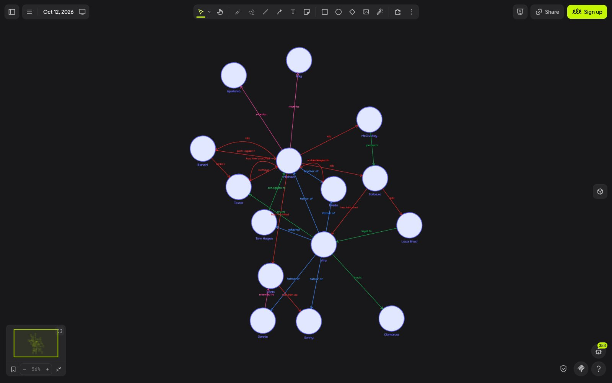

# Relationships — Drawdy extension

Map who is connected to whom: avatar bubbles for people, labeled arrows for how they relate, and color presets for the kind of relation.

Install the extension, right-click the canvas, choose **Extension → Add person**, then connect two people from the **Relationships panel**.

## How to use

1. **Add people.** Right-click the canvas and choose **Extension → Add person**. A bubble appears with a name underneath; double-click the name to edit it.
2. **Add a face.** Drop an image onto a bubble, or drag an image over one. It is center-cropped into a circle and fitted inside the bubble.
3. **Connect people.** Open **Extension → Relationships panel**. Drag a box around two people (the first selected is *from*, the second is *to*), type a label such as "sister of", pick a type and press **Connect**. Add as many relations between the same two people as you need; they fan out so each stays readable.
4. **Tidy up.** Press **Arrange everyone** in the panel (or **Extension → Arrange everyone**) to move related people close together and cut down arrow crossings.

| Interaction | What happens |
| --- | --- |
| Drag a person | Their name and avatar move with them and their arrows follow. |
| Save a preset | Adds a relation type with its own color; arrows of that type recolor at once. |
| Drop an image outside any bubble | Stays a normal image. |

Built-in types: Family, Romance, Ally / friend, Enemy, Work. Presets are stored in your browser.

## Works with the Drawdy MCP

People are circles and relations are arrows bound to them, so a board built through the Drawdy MCP works here and the reverse. Arrange treats any arrow attached at both ends to a person as a relation.

## Credits

Built with the [Drawdy extension SDK](https://ddp.drawdy.io/quickstart).
